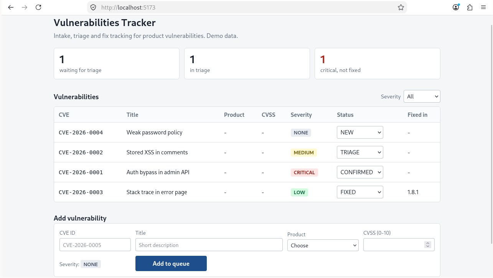

# Vulnerabilities Tracker


A small educational project built to learn how a Product Security
Incident Response Team (PSIRT) works in practice.

I modeled the core parts of the workflow: tracking vulnerabilities, affected products and versions,
severity (CVSS), and the case lifecycle from report to published advisory.

This is a learning project, which goal is to show how these concepts translate into a data model,
an API, and a simple dashboard.



## Architecture

The project consists of three parts:

| # | Component | Technology | Role |
|---|-----------|------------|------|
| 1 | Database | PostgreSQL | Stores vulnerabilities, products, versions and statuses |
| 2 | Backend | Java | REST API with business logic and data access |
| 3 | Frontend | Vue.js | Visualization and UI for working with cases |

### 1. Database (PostgreSQL)

The database runs in a Docker container. On the first start it is
automatically initialized with **fictional sample data** (made-up products and vulnerabilities), so the dashboard has something to show right away.

All data is stored in a Docker volume, so it survives container restarts.
It is only wiped when you explicitly remove the volume.

### 2. Backend (Java)

Using JDBC (Java database connectivity) to connect to a PostgreSQL database server.
JDBC is a Java API used to connect to database, send queries, retrieve and process the response to a query. With JDBC, a database is represented by a URL (Uniform Resource Locator):  ```jdbc:postgresql://host:port/database```

Using `SpringBoot` framework to build a Java backend server, develop REST APIs, connect a PostgreSQL database, and enable communication between the frontend and backend. Using `Maven` (`pom.xml`) to manage project dependencies, configure the build process, and integrate `Spring Boot`.

Backend runs in a Docker container, which is created in two stages:  
- the first stage compiles the Java code and packages the application and its dependencies into an executable .jar archive;  
- the second stage runs it using Java Runtime Environment (JRE).

### 3. Frontend (Vue.js)

Dashboard and case views: open cases, severity distribution, case details.

## Usage

### Prerequisites

- Docker with Docker Compose

No local Java, Node.js or PostgreSQL installation is needed.

### Start

```bash
docker compose up --build
```

### Stop

```bash
docker compose down
```

Containers are removed, but the database volume (and your data) is kept.

### Reset the database

To remove containers and the volume with all data:

```bash
docker compose down -v
```

The next `docker compose up` will create a fresh database and load
the sample data again.